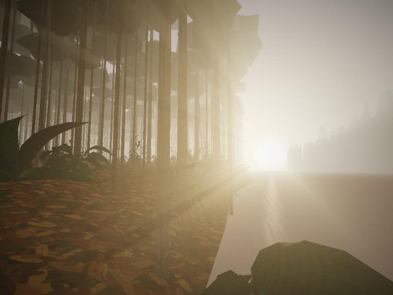
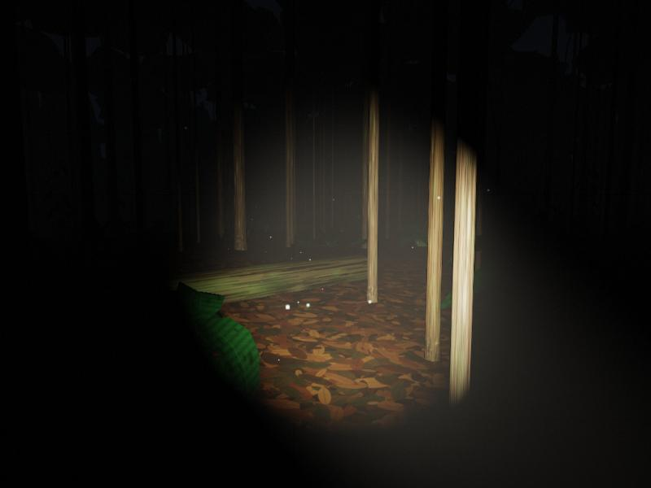
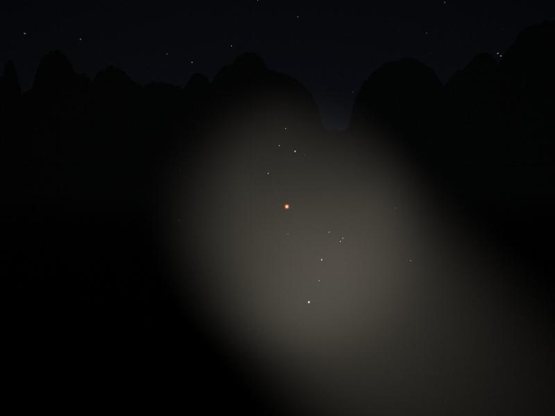
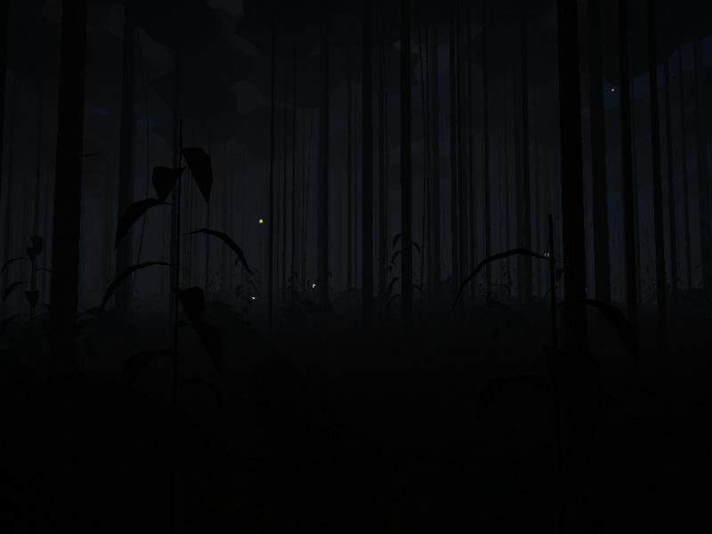
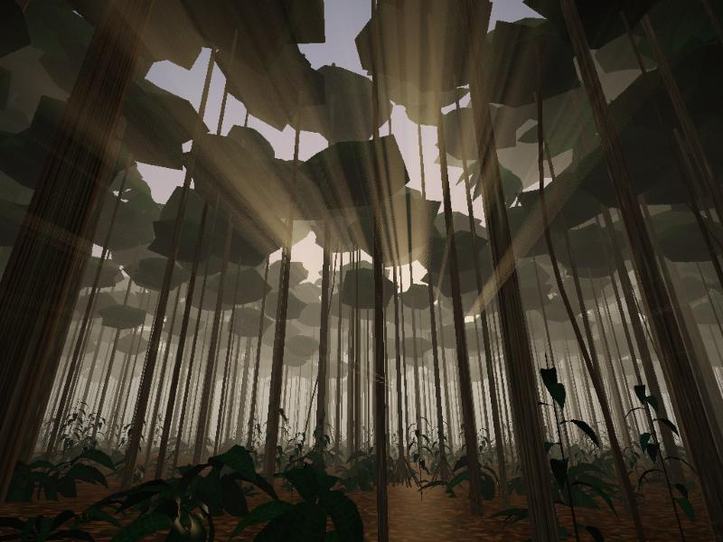

<a href="https://pratyushshivam.github.io/understory/"></a>

<p align="center">
  <a href="https://pratyushshivam.github.io/understory/"><b>Open it</b></a> ·
  <a href="#the-night">The night</a> ·
  <a href="#what-is-real-and-what-is-not">What is real</a> ·
  <a href="#who-is-out-there">Who is out there</a> ·
  <a href="#sound">Sound</a> ·
  <a href="#run-it">Run it</a> ·
  <a href="https://www.pratyushshivam.com/">pratyushshivam.com</a>
</p>

# Understory

**One night on the floor of the Amazon, with one torch.** You stand in lowland rainforest at Yasuní, in Ecuador, as the light goes. Your torch shows a cone of wet leaves, trunks and mist. Everything else is black, and full of sound. Eyes shine back at you in the colour each animal's eyes really shine. Rain comes and passes. The forest goes quiet once, for a reason. Then the sky greys, the howler monkeys start, and the dawn chorus builds until the sun comes up along the river.

The whole night, 17:45 to 06:25, plays in about ten minutes. Every animal in it is recorded from this forest, sits at the height it really lives at, and is out at the hours it is really out. Most of them you will only hear.

**Open:** [pratyushshivam.github.io/understory](https://pratyushshivam.github.io/understory/). Headphones, and a dark room.

<table>
<tr>
<td width="50%" valign="top"><br><sub><b>One torch.</b> The beam is the only light. Mist scatters it; small insects show only when they cross it.</sub></td>
<td width="50%" valign="top"><br><sub><b>Something is looking back.</b> A black caiman, 30 m out. Eyeshine is your own torch, returned.</sub></td>
</tr>
<tr>
<td width="50%" valign="top"><br><sub><b>Torch off.</b> Wait, and your eyes arrive: fireflies, and leaf litter that glows.</sub></td>
<td width="50%" valign="top"><br><sub><b>Dawn.</b> The canopy you could not see all night is 25 m overhead, and the light comes down through it.</sub></td>
</tr>
</table>

| | |
| :-- | :-- |
| **The place** | Terra firme forest at Tiputini Biodiversity Station, Yasuní, Ecuador. 0°37′ S, 76°10′ W, 190 to 270 m |
| **Who is in it** | 58 entries: 52 named species, 5 insect and spider groups, and one fungus that has no name yet. About 560 individual animals in a night |
| **Voices** | 25 real field recordings (xeno-canto, Creative Commons), 3 synthesised insect groups, 6 species left silent because no shareable recording exists |
| **The forest** | 4 hectares at the measured density: 702 trees per hectare, one in ten a stilt palm, heights from the published curve for western Amazonia |
| **Weight** | 2.7 MB for everything, of which 1.6 MB is the recordings |
| **Stack** | TypeScript, three.js on WebGL2, Web Audio with HRTF panning, Vite. Static files only. A pure TypeScript core with 52 tests |

## The night

| Clock | What happens | Why |
| :-- | :-- | :-- |
| 17:45 | Dusk. Cicadas, tinamous, a woodcreeper. The light fails fast | On the equator the Sun sets almost vertically, 15° an hour: civil twilight lasts about 24 minutes |
| 18:45 | Night. Frogs, katydids, crickets. Potoos and owls start | 95% of the tree frogs found at Tiputini were found at night |
| 23:00 | Deep night. Fewer voices, larger ones | Opossums are busiest between 23:00 and 03:00 |
| some time | Thunder, then a minute of rain. Birds stop, frogs get louder afterwards, leaves drip | |
| later | A branch breaks behind you. Later still, everything alive goes quiet | Something large is near |
| 03:30 | The lull before first light | |
| 05:00 | The forest falcon calls in the dark. Then the howlers | At Tiputini the howling is already under way when recorders start at 05:45 |
| 06:00 | Sunrise. Toucans, the screaming piha, macaws over the river | |

Dusk and dawn are played slower than the middle of the night, so the two choruses have room: 45 real seconds per second at dusk, 100 in the night, 33 at dawn. The mapping is in [`src/core/time.ts`](src/core/time.ts).

Each night has a number, taken from the date, and the same number is the same night for everyone: the same trees, the same animals in the same places, rain at the same minute. Add `?night=123` to the address to walk a particular one.

**Things to do**, none of them required: follow a whistle to the bird that makes it, reach the river, switch the torch off and wait, and meet twelve animals before the sun does. Hold the torch on an animal and its card appears, with one fact and its source. The notebook (`N`) keeps what you met and what you only heard. At dawn it tells you how many were there all night and never let you know.

**Controls.** `W A S D` walk, mouse looks, `Shift` hurries, `F` or click for the torch, `N` for the notebook. On a phone: left thumb walks, right thumb looks.

## What is real, and what is not

| | What you get | Where it comes from |
| :-- | :-- | :-- |
| **The place** | A real station with real species lists | Cisneros-Heredia 2003; Blake 2021; Blake & Loiselle 2015; Bass et al. 2010 |
| **Who lives here** | Every entry has a record from Tiputini or the Yasuní reserve, linked in the notebook and in [`species.ts`](src/core/species.ts) | Station lists, published plots, iNaturalist research-grade records |
| **Tree density** | 702 trees of 10 cm or more per hectare; 10.3% are the stilt palm *Iriartea deltoidea* | Valencia et al. 2004, the 25-ha Yasuní plot |
| **Tree height** | H = 46.263 · (1 − e^(−0.0876 · D^0.6072)), canopy with emergents of 40 to 50 m | Feldpausch et al. 2012, Table 3, western Amazonia; Valencia et al. 2004 |
| **Light** | Floor light is 1.5% of open sky; twilight follows the standard illuminance values for the Sun's angle | Chazdon & Fetcher 1984 (1 to 2%, measured in Costa Rica) |
| **Eyeshine** | Brightness falls with the fourth power of distance and with the area of the pupil. Animals with no reflecting layer do not shine at all | [`optics.ts`](src/core/optics.ts), tested |
| **Sound** | Loudness from distance (6 dB per doubling) plus what the forest absorbs, high notes first | [`acoustics.ts`](src/core/acoustics.ts), tested |
| **Hours** | Each species is out, and calls, only in its own hours | Sources per species; see the limits below |

**What is not real, or not measured.** This list is as much a part of the project as the one above.

- **The ground plan is generated.** Density, palm share and heights follow the papers; the position of each tree does not. Trunk diameters follow a fitted curve, not the plot's tally. There are no species of tree except the stilt palm, and crowns are simple shapes.
- **Eyeshine colours are mostly group-level.** Species-level sources exist only for the ocelot (golden), the Amazon tree boa and the great potoo (present). The rest follow their group: frogs and spiders green, owls, opossums and rodents red, cats golden, caimans red-orange. The orange drawn for potoos, nightjars, the boa and the kinkajou, and the pale shine of the tapir, are assumptions and say so on their cards. Night monkeys are disputed in the literature, so they are drawn with almost none.
- **Calling hours are typical, not measured here**, except where a Tiputini study gives them (howlers and screech owl at 05:45, woodcreeper at dawn and dusk, forest falcon before dawn, tinamou in the evening). No hourly activity curves exist for most of these species at this site. The order of the dawn chorus is built from those per-species sources; the one published study of dawn order in Ecuador (Berg et al. 2006) was done in the west of the country, not here, and is not used as a timetable.
- **Loudness values are estimates**, except the screaming piha (over 110 dB at 1 m). The forest's absorption is a smooth curve fitted to the published pattern, not a measurement at Yasuní.
- **Insects are groups, not species.** Katydids, crickets, cicadas and fireflies are placed and heard, but which species live at Tiputini was not established for this build, and their songs are synthesised. A quiet layer of distant insect song stands for the ones beyond the patch you can walk.
- **Six animals are silent** because no recording with a licence that allows sharing was found: the Manaus slender-legged tree frog, white-lined leaf frog, triangle tree frog, Amazon milk frog, Ecuador poison frog and Spix's night monkey. Nothing stands in for them. Bats are silent because they call above human hearing.
- **Some recordings are the right species from the wrong place**, and two are the wrong kind of call. The howler was recorded in Brazil, several frogs in Peru, French Guiana or Brazil, the kinkajou on the Andean slope; the titi monkey clip is alarm calls, not the morning duet. Each is noted in [CREDITS.md](CREDITS.md).
- **Rain, thunder, wind, the river, footsteps, the breaking branch and the falling tree are synthesised.**
- **The stars are not a catalogue**, and the night has no Moon.
- **The jaguar comes to you.** Jaguars are recorded at Tiputini, but meeting one on a single night walk would be rare luck. Here it happens once every night.
- **The animals are built from simple shapes**, at their true sizes, and do not move from their perches (bats, macaws and fireflies fly).
- **Time is compressed**, and unevenly, as described above.

## Who is out there

Frogs and toads (10): smoky jungle frog, Manaus slender-legged tree frog, rocket tree frog, giant gladiator tree frog, cane toad, white-lined leaf frog, tiger-striped leaf frog, triangle tree frog, Amazon milk frog, Ecuador poison frog.

Snakes and caimans (7): Amazon tree boa, common lancehead, blunt-headed tree snake, rainbow boa, smooth-fronted caiman, black caiman, spectacled caiman.

Birds (17): common potoo, great potoo, tawny-bellied screech owl, crested owl, spectacled owl, common pauraque, ocellated poorwill, great tinamou, variegated tinamou, lined forest falcon, buff-throated woodcreeper, black-faced antthrush, musician wren, white-throated toucan, screaming piha, russet-backed oropendola, scarlet macaw.

Mammals (11): Colombian red howler, white-tailed titi, Spix's night monkey, kinkajou, ocelot, jaguar, lowland paca, South American tapir, common opossum, nine-banded armadillo, chestnut short-tailed bat.

Spiders, insects and their kin (12): Amazonian wandering spider, giant fishing spider, Amazonian pinktoe tarantula, tailless whip scorpion, bullet ant, leafcutter ants, owl butterfly, and five groups (small wandering spiders, katydids, crickets, cicadas, fireflies).

Fungi (1): the glowing leaf litter of Yasuní, a *Mycena* that has not yet been described (Blanchette 2024).

Where each one sits is a rule, and the rules are tested: caimans in the river and the forest stream, the tree boa on a branch, tarantulas and whip scorpions on trunks, kinkajous and howlers 18 m and more above you, the potoo on a stub 5 to 8 m up.

## Sound

Sound is most of the experience, so it is done carefully.

- **Every voice belongs to a placed animal.** A call is played from where that animal sits, through an HRTF panner, so with headphones you can turn toward it and walk to it.
- **Distance is worked out, not faked.** Level falls 6 dB per doubling, plus the forest's own loss, which rises with pitch. A low-pass filter follows the same curve, so far calls sound dull and deep voices carry: the howler reaches across the whole site, a katydid a few tens of metres.
- **25 recordings** by John V. Moore, Niels Krabbe, Mitch Lysinger, Paul Coopmans, Juan Freile, Fabrice Schmitt, M. S. Hoogmoed and others, shared on [xeno-canto](https://xeno-canto.org/) under Creative Commons licences that allow adaptation. Each is trimmed to one clear call. Nothing is pitch-shifted, sped up or layered. Recordist, licence, link and the exact seconds used are in [CREDITS.md](CREDITS.md); the build script is [`scripts/build-audio.mjs`](scripts/build-audio.mjs).
- **Rain changes who sings.** Birds stop, frogs call more for a while afterwards, and water keeps falling from leaf to leaf.

The mix was balanced from the numbers, and has not yet been tuned by ear on good headphones.

## How it stays light

- One draw call per species and per forest chunk: about 2,400 trunks, 5,400 understory plants and 560 animals are instanced.
- The torch is at your eye, so its shadows hide behind the things that cast them and no shadow maps are needed.
- Mist in the beam is 14 steps of ray marching in one full-screen pass (8 on phones), which also does the dawn shafts, tone mapping and grain.
- Eyeshine is computed per eye on the CPU with the same function the tests check, and drawn as points.
- If the frame rate drops, resolution is lowered before anything else.

### Sources

- Bass, M. S. et al. 2010. [Global conservation significance of Ecuador's Yasuní National Park](https://journals.plos.org/plosone/article?id=10.1371/journal.pone.0008767). PLoS ONE 5(1): e8767.
- Cisneros-Heredia, D. F. 2003. [The amphibians and reptiles of Tiputini Biodiversity Station](https://multimedia20stg.blob.core.windows.net/publicaciones/Cisneros_Heredia_2003.pdf) (in Spanish; the station's full species list, 185 species).
- Blake, J. G. 2021. [Acoustic monitors and direct observations of birds at Tiputini](https://pmc.ncbi.nlm.nih.gov/articles/PMC7811295/). PeerJ 9: e10565.
- Blake, J. G. & Loiselle, B. A. 2015. [Bird numbers on the Tiputini study plots](https://pmc.ncbi.nlm.nih.gov/articles/PMC4558082/). PeerJ 3: e1177.
- Valencia, R. et al. 2004. [Tree species distributions and local habitat variation in the Amazon: large forest plot in eastern Ecuador](https://ctfs.si.edu/Public/pdfs/Condit_valenciaetal.JEcol.2004.pdf). Journal of Ecology 92: 214–229.
- Feldpausch, T. R. et al. 2012. [Tree height integrated into pantropical forest biomass estimates](https://bg.copernicus.org/articles/9/3381/2012/). Biogeosciences 9: 3381–3403.
- Chazdon, R. L. & Fetcher, N. 1984. Photosynthetic light environments in a lowland tropical rain forest in Costa Rica. Journal of Ecology 72: 553–564.
- Paper titles above are given in full only where they were checked against the paper; the others are described.
- Blanchette, R. A. 2024. [The glowing leaf litter of Yasuní](https://www.fungimag.com/v17i1/V17I1-Blanchette.pdf). Fungi 17(1).
- [Passive acoustic monitors at Tiputini Biodiversity Station](https://sites.google.com/miamioh.edu/passiveacousticmonitorstbs/home), Miami University.
- Species facts link to their own sources on each card, mostly Wikipedia and Animal Diversity Web. Conservation statuses are as listed on those pages.

## Run it

```bash
npm install
npm run dev
```

```bash
npm test
```

```bash
npm run build
```

`node scripts/build-audio.mjs` rebuilds the clips from the original recordings (needs `ffmpeg` and `curl`).

Add `?debug` to the address to get a `game` object in the console, with `game.debug.setTime(seconds)`, `teleport(x, z)` and `nearest('kinkajou')`.

## How it is put together

| | |
| :-- | :-- |
| [`src/core`](src/core) | No graphics, no audio: the clock and the Sun, the seeded forest and placement rules, the species table, torch and eyeshine optics, forest acoustics. Everything the tests cover |
| [`src/render`](src/render) | three.js: forest, animal bodies, eyeshine, air and rain, the post pass |
| [`src/audio`](src/audio) | Web Audio: placed voices, the continuous singers, weather, synthesis |
| [`src/game.ts`](src/game.ts) | You, the torch, the night's events, finding and goals |
| [`tests`](tests) | 52 tests: clock, twilight, inverse-square and fourth-power laws, attenuation, activity windows, dawn order, placement by layer, determinism, and that every voice has a credit |

No account, no server, no tracking, nothing to upload.

## Licence

Code: [MIT](LICENSE). The recordings in `public/audio` are not MIT: each stays under the Creative Commons licence its recordist chose (most are CC BY-NC-SA, so non-commercial and share-alike), listed in [CREDITS.md](CREDITS.md).
